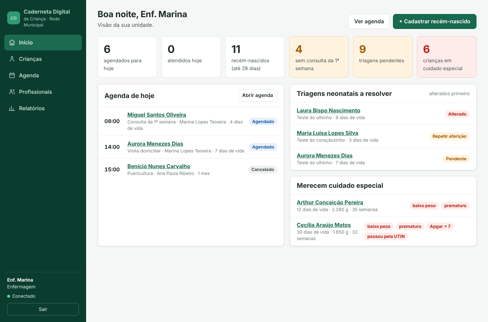

# Caderneta Digital da Criança · A3 Banco de Dados

Projeto Integrador de Banco de Dados (UNIFACS, 2026.2). Cenário **Clínica SaúdeDigital**, contexto **redesenho de atendimento**: digitalização da Caderneta da Criança (pré-natal, parto, nascimento, internação neonatal, alta, triagens neonatais e consulta da 1ª semana) para uma rede municipal de saúde.

- **Banco:** Microsoft SQL Server (T-SQL) em VM VirtualBox, com 7 schemas, 33 tabelas, 5 views, 4 funções, 5 procedures e 9 triggers
- **Backend:** Node.js + Express em camadas (routes → controllers → services → repositories); todo o SQL fica nos repositories
- **Frontend:** HTML, CSS e JavaScript puros, com o fluxo de preenchimento redesenhado



## Começo rápido

```bash
# 1. SQL Server rodando na VM (veja docs/06-guia-vm-sqlserver-dbeaver.md)
cd backend
npm install
cp .env.example .env        # Windows: copy .env.example .env  → ajuste DB_SERVER e DB_ADMIN_PASSWORD
npm run db:setup            # cria banco, tabelas, objetos, dados de teste e permissões
npm start                   # http://localhost:3000
```

Usuários de teste (senha `caderneta123`): `recepcao@`, `enfermeira@`, `tecnica@`, `medico@`, `gestor@caderneta.local`.

## Estrutura

```
database/   scripts SQL separados por tipo: DDL, programabilidade, DML, DQL, DCL
backend/    API Node.js (Express + mssql)
frontend/   telas HTML/CSS/JS
docs/       arquitetura do banco, DER, normalização 3FN, dicionário, guia da VM, roteiro
```

Comece pela [documentação](docs/README.md).

## Entregas do edital → onde estão

| Entrega | Local |
|---|---|
| DER em alta resolução | `docs/img/der.svg`, `docs/02-der.md` |
| Memorial de normalização (3FN) | `docs/03-normalizacao-3fn.md` |
| Dicionário de dados | `docs/04-dicionario-de-dados.md` |
| Requisitos e regras de negócio | `docs/05-requisitos-e-regras-de-negocio.md` |
| Scripts SQL (DDL, DML, DQL) comentados | `database/` |
| Código da aplicação comentado | `backend/src`, `frontend/` |
| Instruções de execução | `docs/06-guia-vm-sqlserver-dbeaver.md` |

> Dados fictícios. Protótipo acadêmico, sem integração oficial com o SUS.
