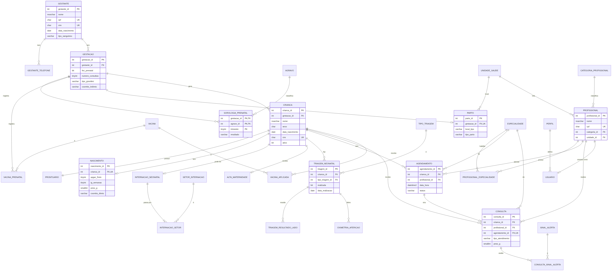
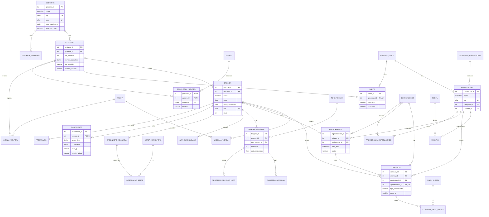

# 2. Diagrama Entidade-Relacionamento (DER)

Versão vetorial (alta resolução, para o relatório): [`img/der.svg`](img/der.svg). Fonte editável: [`der.mmd`](der.mmd) (Mermaid; abre no VS Code, no GitHub ou em mermaid.live).

> Para não poluir o desenho, só as entidades principais mostram atributos. A lista completa de colunas está no [dicionário de dados](04-dicionario-de-dados.md). O DBeaver também gera o diagrama físico a partir do banco: botão direito no banco → **View Diagram**.

## Cardinalidades (leitura em português)

| Relacionamento | Cardinalidade | Como está implementado |
|---|---|---|
| Gestante tem gestações | 1 : N | FK `gestacao.gestante_id` |
| Gestante tem telefones (multivalorado) | 1 : N | tabela `gestante_telefone` |
| Gestação gera crianças (gêmeos = 2) | 1 : 1..N | FK `crianca.gestacao_id` (NOT NULL) |
| Gestação termina em parto | 1 : 0..1 | FK `parto.gestacao_id` + **UNIQUE** |
| Gestação × agravo × trimestre → sorologia | N : N (com atributo) | PK composta `(gestacao_id, agravo_id, trimestre)` |
| Gestação × vacina (pré-natal) | N : N | PK composta `(gestacao_id, vacina_id)` |
| Criança possui prontuário | 1 : 1 | `prontuario.crianca_id` UNIQUE; criado por trigger |
| Criança tem nascimento | 1 : 0..1 | `nascimento.crianca_id` UNIQUE |
| Criança tem internação neonatal | 1 : 0..1 | `internacao_neonatal.crianca_id` UNIQUE |
| Internação passa por setores | N : N (com dias) | PK composta `(internacao_id, setor_id)` |
| Criança recebe alta da maternidade | 1 : 0..1 | `alta_maternidade.crianca_id` UNIQUE |
| Criança faz triagens (um registro por tipo) | 1 : 0..4 | UNIQUE `(crianca_id, tipo_triagem_id)` |
| Triagem tem resultado por lado | 1 : 0..2 | PK `(triagem_id, lado)` + CHECK lado IN (D,E) |
| Triagem (coraçãozinho) tem aferições | 1 : 0..2 | PK `(triagem_id, numero_afericao)` |
| Profissional × especialidade | N : N | tabela associativa `profissional_especialidade` |
| Profissional lotado em unidade | N : 1 | FK `profissional.unidade_id` |
| Criança tem agendamentos | 1 : N | FK `agendamento.crianca_id` |
| Agendamento vira consulta | 1 : 0..1 | `consulta.agendamento_id` com índice único filtrado |
| Consulta avalia sinais de alerta | N : N (Sim/Não) | PK `(consulta_id, sinal_alerta_id)` |
| Criança recebe vacinas | 1 : N | UNIQUE `(crianca_id, vacina_id, dose)` |
| Profissional acessa como usuário | 1 : 0..1 | `usuario.profissional_id` com índice único filtrado |

## Código-fonte do diagrama

