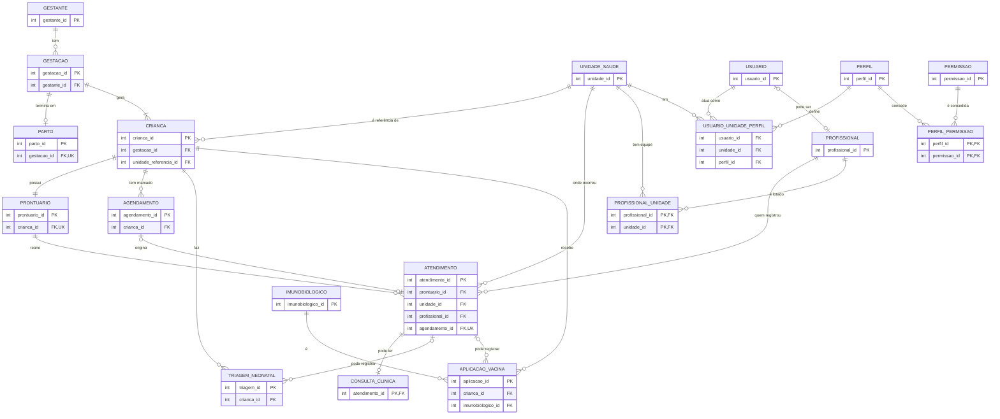

# Redesenho do DER — Caderneta Digital da Criança (proposta)

> **Status:** proposta lógica para validação. Nenhum script SQL, backend ou frontend foi alterado. O modelo atual (`docs/der.mmd`, `database/01_ddl/`) continua intacto.
> **Base analisada:** cópia local do projeto no commit `b2bdcc3` (pode diferir da `main` remota).

## 0. Resumo executivo

- O DER atual é **bom em decisões de fundo** (gestação como eixo, parto 1:0..1 por gestação, nascimento por criança, catálogos, agenda separada de atendimento). O problema é menos de modelagem e mais de **três falhas concretas**: restrições `UNIQUE` que impedem histórico real, segurança sem escopo por unidade e vacinação sem calendário nem distinção aplicação/transcrição.
- O novo desenho **não reduz o número de tabelas**: vai de **33 para 44** (32 de negócio + 12 catálogos), porque acrescenta o que falta (permissões granulares, vínculo usuário-unidade-perfil, acesso excepcional, esquema vacinal, lotação de profissional por unidade). A simplificação está na **apresentação**: o diagrama principal passa a ter **19 entidades só com chaves**, em vez de um único desenho misturando tudo.
- Nenhum campo clínico da seção 4 do prompt foi removido. Dois campos hoje **sem coluna** foram acrescentados (rede de apoio/participação familiar; encaminhamento da triagem).

**Limitações desta análise (leia antes de usar):**
1. `A3_Redesenho_Saude.pdf` **não estava na pasta**. A única PDF é `docs/Relatorio_Tecnico_A3_CadernetaDigital.pdf`. Usei a seção 4 do prompt como checklist clínico. Recomendo conferir o resultado contra o formulário original.
2. Li os DDL, triggers, funções/views (cabeçalhos), DCL, `permissoes.js`, `auth.js`, rotas, controllers e repositórios-chave, e `docs/01`, `02`, `05`. **Não li em profundidade** `docs/03`, `04`, `07`, nem o JavaScript/HTML do frontend; as recomendações de frontend são, por isso, limitadas.

---

## 1. Diagnóstico do DER atual

### 1.1 O que está bom e deve ser mantido

| Decisão atual | Onde | Veredito |
|---|---|---|
| Gestação como eixo; criança → gestação → gestante (sem copiar dados da mãe) | `06_tabelas_gestacao_parto.sql`, `07` | Manter |
| Parto 1:0..1 por gestação (`uq_parto_gestacao`); nascimento 1:1 por criança | `06`, `07` | Manter (gemelar funciona) |
| Sorologia como linha `(gestação, agravo, trimestre)` em vez de 12 colunas | `sorologia_prenatal` | Manter |
| Adequação AIG/PIG/GIG **não armazenada** (função + tabela de referência) | `fn_classificar_peso_ig`, `referencia_peso_ig` | Manter |
| Agendamento separado de consulta | `agendamento`, `consulta` | Manter (renomeando a consulta para atendimento) |
| Catálogos em `dominio` | `04_tabelas_dominio.sql` | Manter |
| Hash bcrypt, `DENY UPDATE/DELETE` no schema `auditoria`, `SESSION_CONTEXT` com o usuário | `08`, `05_dcl`, `db.js:126` | Manter e ampliar |

### 1.2 Problemas encontrados (com evidência)

| # | Problema | Evidência | Gravidade |
|---|---|---|---|
| P1 | **Triagem só admite uma tentativa por tipo**; reteste sobrescreve. O backend faz `MERGE` e depois `DELETE` + reinsere resultados, perdendo o anterior. | `uq_triagem_crianca_tipo` (`07`); `cadernetaRepository.js:334-341` | Alta |
| P2 | **Uma internação por criança** e **um setor por internação**: não registra reinternação nem UTIN → UCINCo → UTIN. | `uq_internacao_crianca`; PK `(internacao_id, setor_id)` em `internacao_setor` (`07`) | Alta |
| P3 | **Vacina sem calendário**, com `UNIQUE (criança, vacina, dose)` que bloqueia correção/reaplicação justificada; `dose` limitada a `DU,D1,D2,D3,REF`; sem fabricante, estratégia, grupo, via, local, nem distinção aplicada × transcrita. Atraso/pendência não tem de onde ser derivado. | `uq_vacina_aplicada_dose`, `ck_vacapl_dose` (`09`) | Alta |
| P4 | **Mistura gestante/criança possível:** `dominio.vacina` tem `publico_alvo`, mas nada impede `vacina_aplicada` apontar para uma vacina só de gestante. | `04`, `09` (sem constraint) | Média |
| P5 | **Exclusão física em cascata:** 14 FKs com `ON DELETE CASCADE`; `DELETE /criancas/:id?fisico=1` apaga todo o histórico clínico. | `07`, `09`; `criancaService.js:95-99`, `criancaRepository.js:111` | Alta |
| P6 | **Gestor enxerga tudo:** o perfil GESTOR recebe `caderneta.ver` (prontuário completo), `criancas.excluir`, `agenda.excluir`; e o dashboard do gestor é da rede inteira. | `permissoes.js:19-23`; `cadastroController.js:14-18` | Alta |
| P7 | **Sem escopo por unidade:** `GET /criancas/:id/caderneta` nem recebe o usuário (`cnt.obter` só usa `req.params.id`); listas aceitam `?unidade_id=` vindo da query. Qualquer usuário com `caderneta.ver` abre qualquer criança de qualquer unidade. | `cadernetaController.js:9`; `cadastroController.js:34`; `agendaController.js:17` | Alta |
| P8 | **Um perfil por usuário e fixo no CHECK**; usuário sem unidade; profissional com **uma** lotação. Não suporta mesma pessoa em duas UBS ou perfis diferentes por unidade. | `ck_perfil_codigo`, `usuario.perfil_id` (`08`); `profissional.unidade_id` (`05`) | Alta |
| P9 | **Autorização escrita em constante e em `if` no service** (`usuario.perfil !== 'GESTOR'`). Além disso `exigir(a, b)` usa `some` (OU), então `DELETE /criancas/:id` passa para quem só tem `criancas.editar` e a barreira real é o `if` do service. | `permissoes.js`, `auth.js:25`, `routes/index.js:43`, `criancaService.js:97` | Média |
| P10 | **Auditoria incompleta:** triggers só em `crianca`, `nascimento`, `agendamento`, `consulta`. Gestação, parto, triagens, vacinas, alta, usuários e permissões não são auditados; leitura/exportação/impressão não existem; o log não tem unidade nem justificativa e guarda JSON clínico completo, legível pela conta da aplicação (`GRANT SELECT ON SCHEMA::auditoria`). | `04_triggers.sql`; `08`; `05_dcl` | Alta |
| P11 | **Tabela `consulta` larga e sem SOAP** (20+ colunas: medidas, aleitamento, desmame, sinais, afeto, conduta). Não há coluna para rede de apoio/participação familiar. Histórico de medidas só existe dentro de consultas. | `09` | Média |
| P12 | **Redundâncias leves:** data de nascimento na criança e hora no nascimento; peso/comprimento da alta repetem o conceito de medida; `especialidade_id`, `tipo_atendimento`, `local_atendimento` e seus CHECKs duplicados entre agendamento e consulta. | `07`, `09` | Baixa |
| P13 | **O diagrama polui por mistura de níveis**: um único desenho com ~38 relações, 11 entidades com atributos e várias sem. | `docs/der.mmd` | (pedido do projeto) |

> **Nota sobre a segurança em SQL Server:** o `GRANT/DENY` por schema (`05_dcl`) protege contra o *tipo de operação* na conta técnica `app_caderneta`, não contra *qual usuário da aplicação* acessa *qual criança*. Como a API usa uma conta compartilhada, a autorização individual só existe se for **reaplicada pela API e pelas consultas**, hoje ausente (P6-P7). Ver seção 8.

---

## 2. Proposta de entidades

**Convenção:** `*` = nova ou muito alterada. Schemas atuais mantidos (`dominio`, `cadastro`, `clinico`, `atendimento`, `seguranca`, `auditoria`, `relatorio`).

### 2.1 Organização e identidade

| Entidade | Responsabilidade | PK | Principais FK | Por que existe |
|---|---|---|---|---|
| `UnidadeSaude` | UBS/USF, maternidade, hospital (CNES) | `unidade_id` | — | Onde ocorre o cuidado |
| `Profissional` | Pessoa que assiste (categoria, conselho) | `profissional_id` | `categoria_id` | Quem registrou. **Perde** `unidade_id` |
| `ProfissionalUnidade`* | Lotação com período | `(profissional_id, unidade_id, inicio)` | profissional, unidade | N:N com vigência (P8) |
| `ProfissionalEspecialidade` | Habilitação | `(profissional_id, especialidade_id)` | ambos | Já existe |

### 2.2 Segurança e auditoria

| Entidade | Responsabilidade | PK | Principais FK | Por que existe |
|---|---|---|---|---|
| `Usuario`* | Credencial (hash), estado | `usuario_id` | `profissional_id` (opc., único) | **Perde** `perfil_id` |
| `Perfil`* | Função institucional + `tipo_escopo` (UNIDADE/REDE) | `perfil_id` | — | Sem `CHECK` fixo de códigos |
| `Permissao`* | Ação granular (`modulo`, `acao`, `exige_vinculo_assistencial`) | `permissao_id` | — | Menor privilégio |
| `PerfilPermissao`* | Perfil concede permissão | `(perfil_id, permissao_id)` | ambos | N:N real |
| `UsuarioUnidadePerfil`* | **Onde** e **como** o usuário atua, com vigência | `vinculo_id` | usuário, unidade (nula = rede), perfil | P8; revogar sem apagar histórico |
| `AcessoExcepcional`* | Acesso fora do vínculo, com justificativa, prazo e revisão | `acesso_id` | usuário, criança, unidade | Requisito 7 |
| `LogAuditoria`* | Quem, quando, onde, ação (I/U/D/READ/EXPORT/PRINT/PERM), entidade, justificativa | `log_id` | sem FK de propósito | Ampliação de P10 |

### 2.3 Ciclo materno-neonatal

| Entidade | Responsabilidade | PK | Principais FK | Por que existe |
|---|---|---|---|---|
| `Gestante` | Cadastro da mãe | `gestante_id` | `unidade_referencia_id` | Não repete dado em gêmeos |
| `GestanteTelefone` | Contatos | `telefone_id` | gestante | Multivalorado (1FN) |
| `Gestacao` | Pré-natal, tipo, risco, Coombs indireto **da mãe** | `gestacao_id` | gestante | Eixo do ciclo |
| `SorologiaPrenatal` | Resultado por agravo × trimestre | `(gestacao, agravo, trimestre)` | gestação, agravo | Grade do papel |
| `VacinaGestante`* | Vacina recebida no pré-natal | `(gestacao, imunobiologico)` | gestação, imunobiológico | Sujeito = gestação (resolve P4). Ganha `situacao` e `data_aplicacao` |
| `Parto` | Local, tipo, acompanhante | `parto_id` | gestação (único), unidade | 1 por gestação |
| `Crianca`* | Cadastro individual | `crianca_id` | gestação, unidade de referência | Ganha `ordem_nascimento` (único por gestação) e `hora_nascimento` |
| `Nascimento`* | Dados individuais do bebê | `crianca_id` (PK=FK) | profissional que assistiu | 1:1 com a criança |
| `InternacaoNeonatal`* | Episódio de internação | `internacao_id` | criança | **Remove** `UNIQUE(crianca)` (P2) |
| `InternacaoSetor`* | Passagem por setor, com ordem e dias | `internacao_setor_id` | internação, setor | PK própria: permite repetir setor |
| `AltaNeonatal`* | Alta; vinculada a internação **ou** à maternidade | `alta_id` | criança, internação (opc.) | Substitui `alta_maternidade` |

### 2.4 Prontuário, atendimento e triagens

| Entidade | Responsabilidade | PK | Principais FK | Por que existe |
|---|---|---|---|---|
| `Prontuario` | Pasta longitudinal, nº sequencial | `prontuario_id` | criança (único) | 1:1 com criança |
| `Agendamento` | Evento **futuro** | `agendamento_id` | criança, profissional, unidade, especialidade | Planejado ≠ realizado |
| `Atendimento`* | Evento assistencial **realizado**: onde, quem, quando, tipo, local (unidade/domicílio) | `atendimento_id` | prontuário, unidade, profissional, agendamento (único, opc.) | Espinha dorsal dos eventos |
| `ConsultaClinica`* | Conteúdo clínico (SOAP, aleitamento, desmame, afeto, rede de apoio, conduta) | `atendimento_id` (PK=FK) | atendimento | Só existe em consulta clínica |
| `MedidaAntropometrica`* | Peso, comprimento, PC com data/hora e `origem` (ATENDIMENTO, ALTA) | `medida_id` | criança, atendimento (opc.) | Histórico independente (P11) |
| `AtendimentoSinalAlerta`* | Sinal avaliado (sim/não) | `(atendimento, sinal)` | atendimento, sinal | Catálogo configurável |
| `TriagemNeonatal`* | **Uma tentativa** de triagem; `triagem_origem_id` aponta a tentativa anterior | `triagem_id` | criança, tipo, atendimento (opc.), origem (opc.) | Remove P1 |
| `TriagemResultado`* | Resultado por item (D/E/único) | `(triagem, item)` | triagem | Substitui `triagem_resultado_lado` |
| `TriagemAfericao` | Oximetria pré e pós-ductal | `(triagem, numero)` | triagem | Só existe para o formato oximetria |

### 2.5 Vacinação da criança

| Entidade | Responsabilidade | PK | Principais FK | Por que existe |
|---|---|---|---|---|
| `Imunobiologico`* | Catálogo (substitui `dominio.vacina`) | `imunobiologico_id` | — | Compartilhado por gestante e criança |
| `EsquemaVacinal`* | Calendário de referência com vigência | `esquema_id` | — | Evoluir calendário sem refazer o banco |
| `DosePrevista`* | Dose, idade mínima/ideal/máxima, intervalo mínimo | `dose_prevista_id` | esquema, imunobiológico | Base para derivar atraso/pendência |
| `AplicacaoVacina`* | Dose **aplicada** ou **transcrita** | `aplicacao_id` | criança, imunobiológico, dose prevista (opc.), unidade (opc.), profissional (opc.), atendimento (opc.), estratégia, grupo, **corrige** (auto-FK) | P3 |
| `EstrategiaVacinacao`, `GrupoAtendimento` | Catálogos pequenos | PK própria | — | Evitam texto livre |

### 2.6 Catálogos mantidos
`Especialidade`, `CategoriaProfissional`, `Agravo`, `SetorInternacao`, `TipoTriagem`, `SinalAlerta`, `ReferenciaPesoIG`.

**O que NÃO é entidade:** views, relatórios, cards de dashboard, menus, situação vacinal (aplicada/prevista/atrasada/pendente), atraso, idade em dias, AIG/PIG/GIG, `Caderneta` (é uma **visão** do prontuário).

---

## 3. Relacionamentos e cardinalidades

| Relação | Card. | Leitura simples |
|---|---|---|
| Gestante → Gestação | 1:N | Uma mulher pode ter várias gestações |
| Gestação → Parto | 1:0..1 | Gestação sem parto registrado ainda; nunca dois |
| Gestação → Criança | 1:1..N | Gemelar gera 2+; pré-natal e parto **não duplicam** |
| Gestação → Sorologia / VacinaGestante | 1:N | Uma linha por célula da grade / vacina |
| Criança → Nascimento | 1:0..1 | Cada bebê tem o seu |
| Criança → Prontuário | 1:1 | Um prontuário longitudinal |
| Criança → InternaçãoNeonatal | 1:0..N | Pode ter zero, uma ou várias |
| Internação → InternaçãoSetor | 1:1..N | Passa por 1+ setores, com ordem |
| Internação → AltaNeonatal | 0..1:0..1 | Alta encerra a internação; alta da maternidade existe sem internação |
| Prontuário → Atendimento | 1:N | Histórico |
| Agendamento → Atendimento | 0..1:0..1 | Nem todo agendamento ocorre; nem todo atendimento foi agendado (visita, demanda espontânea) |
| Atendimento → ConsultaClinica | 1:0..1 | Sala de vacina não tem SOAP |
| Atendimento → Medida / SinalAlerta / Triagem / Aplicação | 1:N (opcional no lado filho) | O evento pode agrupar, mas o registro **não depende** dele |
| Criança → Triagem | 1:N | Tentativas; reteste aponta a tentativa anterior |
| Triagem → Resultado / Aferição | 1:N | Lateralidade; repetições de oximetria |
| Imunobiológico × Esquema → DosePrevista | N:N com atributos | Calendário |
| Criança → AplicaçãoVacina | 1:N | Histórico; correção = nova linha apontando a anterior |
| Usuário → UsuárioUnidadePerfil → (Unidade, Perfil) | 1:N | Mesma pessoa, vários papéis/unidades |
| Perfil ↔ Permissão | N:N | Menor privilégio |
| Profissional ↔ Unidade | N:N com vigência | Vários locais |
| Usuário → Profissional | 0..1:0..1 | Recepção e gestão podem não ser assistenciais |
| Criança ↔ Unidade | referência (N:1) × atendimento (N:1 por evento) | **Dois conceitos distintos**: a UBS de referência não é onde o atendimento ocorreu |

---

## 4. Matriz de permissões

Legenda: ● permitido no escopo do vínculo · ◐ restrito (ver nota) · — negado.
Escopo: **U** = só as unidades onde o usuário tem vínculo ativo · **R** = rede (somente se o perfil for do tipo REDE).

| Ação (código da `Permissao`) | Recepção | Téc. Enf./Vacinador | Enfermeiro | Médico | Gestor UBS | Gestor Rede | Admin |
|---|---|---|---|---|---|---|---|
| `cadastro.ver` (identificação, contato) | ● U | ● U | ● U | ● U | ◐ U¹ | — | — |
| `cadastro.editar` | ● U | — | ◐ U² | — | — | — | — |
| `agenda.ver` / `agenda.gerenciar` | ● / ● U | ● / — | ● / ◐ | ● / ◐ | ● / ● U | — | — |
| `clinico.ver` (detalhes, SOAP, diagnósticos) | — | ◐ U³ | ● U⁴ | ● U⁴ | — | — | — |
| `consulta.registrar` (SOAP) | — | — | ● U | ● U | — | — | — |
| `triagem.registrar` | — | ◐ U⁵ | ● U | ◐⁵ | — | — | — |
| `vacina.registrar` | — | ● U⁵ | ● U | ◐⁵ | — | — | — |
| `registro.corrigir` / `registro.anular` | — | ◐ próprios | ◐ próprios | ◐ próprios | — | — | — |
| `indicadores.agregados` (sem identificação) | — | — | ◐ própria equipe | ◐ própria equipe | ● U | ● R | — |
| `pendencias.nominais` (nome + doses/triagens pendentes) | — | — | ● U | ● U | ● U⁶ | ◐ R⁶ | — |
| `dados.exportar` / `dados.imprimir` | — | ◐ | ◐ | ◐ | ◐ agregado | ◐ agregado | — |
| `equipe.gerenciar` (vincular/desvincular) | — | — | — | — | ◐ U | — | ● |
| `usuario.administrar` / `perfil.administrar` | — | — | — | — | — | — | ● |
| `auditoria.ver` | — | — | — | — | ◐ U⁷ | ◐ R⁷ | ◐⁷ |
| `acesso_excepcional.solicitar` | — | ◐ | ● | ● | — | — | — |
| `acesso_excepcional.revisar` | — | — | — | — | ◐ U⁷ | ◐ R⁷ | — |

Notas:
1. Gestor UBS vê identificação mínima apenas na lista nominal de pendências.
2. Enfermeiro corrige dado cadastral da criança; decisão de gestão da unidade.
3. Técnico vê só o que a função exige: vacinas, triagens, medidas. **Sem** SOAP/diagnósticos.
4. `clinico.ver` exige **vínculo assistencial**: a criança tem a unidade do usuário como referência **ou** teve atendimento naquela unidade, **ou** há `AcessoExcepcional` vigente.
5. **Depende de habilitação profissional e norma institucional. Não inventei a regra; validar com a gestão/COREN/CRM.**
6. Finalidade administrativa (cobrança de pendências). **Validar com o encarregado LGPD.** Sem conteúdo clínico.
7. Metadados e justificativa; **sem** valores clínicos antes/depois.

**Regra central:** a amplitude do gestor é *operacional* e limitada à unidade; **nenhum perfil recebe `clinico.ver` por ser gestor ou administrador.**

---

## 5. DER conceitual principal

Arquivo: `der-principal.mmd` (SVG renderizado em `der-principal.svg`). Caminho do cuidado: **Gestante → Gestação → Parto / Criança → Prontuário → Atendimento → (Consulta | Triagem | Vacinação)**. Em paralelo: **Usuário → Vínculo Unidade/Perfil → Perfil → Permissões**.

## 6. DERs por módulo

| Módulo | Arquivo | Conteúdo |
|---|---|---|
| A. Ciclo materno-neonatal | `der-ciclo-materno-neonatal.mmd` | Gestante, gestação, sorologia, vacina da gestante, parto, criança, nascimento, internação, setores, alta |
| B. Atendimento e vacinação na APS | `der-aps-vacinacao.mmd` | Agendamento, atendimento, consulta clínica, medidas, sinais, triagens, calendário, aplicação |
| C. Segurança e auditoria | `der-seguranca.mmd` | Usuário, perfil, permissão, vínculo unidade-perfil, acesso excepcional, auditoria, lotação |

Todos os quatro `.mmd` passaram na validação do parser Mermaid 10 e foram renderizados em SVG.

### Modelo lógico resumido (atributos-chave além de PK/FK)

- **Crianca:** `nome`, `sexo`, `data_nascimento`, `hora_nascimento`, `cns` (único filtrado), `tipo_sanguineo`, `fator_rh`, `ordem_nascimento` (`UNIQUE (gestacao_id, ordem_nascimento)`), `ativo`, `motivo_inativacao`.
- **Nascimento:** pele a pele, mamou na 1ª hora, Apgar 1'/5', clampeamento oportuno, `ig_semanas`/`ig_dias`/`ig_metodo`, peso/comprimento/PC ao nascer, reanimação, `assistido_por_id`, `coombs_direto` (do bebê), profilaxia oftálmica, vitamina K.
- **Atendimento:** `tipo_atendimento` (PRIMEIRA_SEMANA, PUERICULTURA, VISITA_DOMICILIAR, SALA_VACINA, TRIAGEM), `local_atendimento`, `data_hora`, `situacao` (REGISTRADO/ANULADO), `corrige_atendimento_id`.
- **MedidaAntropometrica:** `origem` (ATENDIMENTO/ALTA), `data_hora`, `peso_g`, `comprimento_cm`, `pc_cm` (ao menos uma preenchida).
- **TriagemNeonatal:** `status` (REALIZADA/NAO_REALIZADA), `data_realizacao`, `metodo` (EOA/PEATE), `observacao`, `encaminhamento`, `situacao`, `triagem_origem_id`.
- **AplicacaoVacina:** `origem` (APLICADA/TRANSCRITA), `dose`, `data_aplicacao`, `lote`, `fabricante`, `via`, `local_aplicacao`, `reaplicacao_justificada`, `situacao` (VALIDA/ANULADA), `corrige_aplicacao_id`. Unidade e profissional **opcionais apenas quando** `origem = TRANSCRITA`.
- **Unicidades justificadas:** `AplicacaoVacina UNIQUE (crianca, imunobiologico, dose) WHERE situacao='VALIDA' AND reaplicacao_justificada=0`; `UsuarioUnidadePerfil UNIQUE (usuario, unidade, perfil) WHERE ativo=1`; `AltaNeonatal UNIQUE (internacao_id)` e `UNIQUE (crianca_id) WHERE internacao_id IS NULL`.

### Cobertura dos campos do PDF (seção 4 do prompt)
Todos têm destino. Novos: `ConsultaClinica.rede_apoio_familia` e `TriagemNeonatal.encaminhamento`. Alterados: peso/comprimento da alta passam a `MedidaAntropometrica(origem=ALTA)`; `data_reteste` vira nova tentativa encadeada.

---

## 7. Plano de migração

| Atual | Proposto | Ação |
|---|---|---|
| `cadastro.unidade_saude` | `UnidadeSaude` | Manter |
| `cadastro.profissional` (`unidade_id`) | `Profissional` + `ProfissionalUnidade` | **Dividir:** cada `unidade_id` vira 1 lotação `principal=1`, `inicio=criado_em` |
| `profissional_especialidade`, `gestante`, `gestante_telefone`, `gestacao`, `sorologia_prenatal`, `parto` | idem | Manter |
| `dominio.vacina` | `Imunobiologico` | **Renomear**; `publico_alvo` mantido como informativo |
| `clinico.vacina_prenatal` (`recebeu`) | `VacinaGestante` | Renomear; `recebeu=1`→`RECEBEU`, `0`→`NAO_RECEBEU`; `data_aplicacao` nula |
| `cadastro.crianca` | `Crianca` | Manter; **calcular `ordem_nascimento`** por `crianca_id` dentro da gestação (revisar manualmente gêmeos) |
| `clinico.nascimento` (`hora_nascimento`) | `Nascimento` + `Crianca.hora_nascimento` | **Mover** a hora |
| `clinico.internacao_neonatal` | `InternacaoNeonatal` | Remover `UNIQUE(crianca)`; dados preservados |
| `clinico.internacao_setor` | `InternacaoSetor` | **Recriar** com PK própria; `ordem` = ordem do `setor_id` (sem info real, marcar como ordem presumida) |
| `clinico.alta_maternidade` | `AltaNeonatal` + `MedidaAntropometrica` | **Dividir:** peso/comprimento da alta → medidas (`origem=ALTA`) |
| `clinico.prontuario` | `Prontuario` | Manter |
| `atendimento.agendamento` | `Agendamento` | Manter |
| `atendimento.consulta` | `Atendimento` + `ConsultaClinica` + `MedidaAntropometrica` | **Dividir:** 1 consulta → 1 atendimento + 1 consulta clínica + 1 medida (se houver); `desenvolvimento_afeto` preservado; `rede_apoio_familia` nula |
| `atendimento.consulta_sinal_alerta` | `AtendimentoSinalAlerta` | Renomear (`consulta_id` → `atendimento_id` mantendo o mesmo valor) |
| `clinico.triagem_neonatal` | `TriagemNeonatal` | Manter linhas como tentativa 1; `realizada`→`status`; `conduta`→`observacao`; `data_reteste` preenchida → criar 2ª tentativa com `triagem_origem_id` |
| `triagem_resultado_lado` | `TriagemResultado` | Renomear; `D/E` → `DIREITO/ESQUERDO` |
| `oximetria_afericao` | `TriagemAfericao` | Renomear |
| `atendimento.vacina_aplicada` | `AplicacaoVacina` | **Estender:** `origem='APLICADA'` por padrão; fabricante, estratégia, grupo, via, local nulos (não existem na origem) |
| — | `EsquemaVacinal`, `DosePrevista`, `EstrategiaVacinacao`, `GrupoAtendimento` | **Novos**; carga a partir de fonte oficial (ver seção 11) |
| `seguranca.perfil` | `Perfil` | Remover `ck_perfil_codigo`; códigos atuais preservados |
| `seguranca.usuario` (`perfil_id`) | `Usuario` + `UsuarioUnidadePerfil` | **Dividir:** 1 vínculo por usuário com a unidade do profissional vinculado; usuários sem profissional precisam de unidade **definida manualmente** |
| — | `Permissao`, `PerfilPermissao`, `AcessoExcepcional` | **Novos**; carga inicial transcrita de `permissoes.js` e **depois reduzida** conforme a matriz |
| `auditoria.log_auditoria` | `LogAuditoria` | Estender (`acao`, `unidade_id`, `justificativa`); linhas antigas: `acao` = I/U/D |

**Estratégia:** scripts versionados `database/06_migracao_v2/` em transação, expand/contract (criar novas → copiar → views de compatibilidade com nomes antigos → trocar backend → remover antigas só depois). Manter `docs/der.mmd` atual como `docs/der-v1.mmd`. Backup antes.

---

## 8. Impacto no SQL Server

- **DDL:** criar tabelas novas; remover `uq_triagem_crianca_tipo`, `uq_internacao_crianca`, `uq_vacina_aplicada_dose` (substituídas pelos índices filtrados); PK de `internacao_setor`; trocar `ON DELETE CASCADE` por `NO ACTION` nas tabelas clínicas (hoje são 14 FKs com cascade em cadastro, clínico e atendimento; só `profissional_especialidade` e `gestante_telefone` podem manter); `ck_perfil_codigo` removido; CHECKs: `origem='TRANSCRITA' OR (unidade_id IS NOT NULL AND profissional_id IS NOT NULL)`; `corrige_*` ≠ próprio id.
- **Índices:** `(crianca_id, data_hora DESC)` em atendimento, medida, triagem; `(vinculo: usuario_id, ativo)`; índice de cobertura para `dose_prevista` por esquema.
- **Views/funções:** `vw_situacao_vacinal` (APLICADA/PREVISTA/ATRASADA/PENDENTE/DISPONIVEL derivada de `DosePrevista` + `AplicacaoVacina` + `fn_idade_em_dias`, **com regra temporal documentada**); `vw_triagem_situacao` passa a usar a **última tentativa válida**; `vw_crianca_resumo` e `vw_linha_tempo_crianca` reescritas; `vw_indicadores_unidade` (agregada, sem PII) separada de `vw_pendencias_nominais`.
- **Procedures:** `sp_registrar_consulta` passa a criar atendimento + consulta clínica + medida numa transação; `sp_agendar_consulta` consulta `ProfissionalUnidade`; novas `sp_anular_aplicacao`, `sp_anular_triagem`, `sp_conceder_acesso_excepcional`. `sp_inativar_crianca` mantida.
- **Triggers:** gerar auditoria **para todas as tabelas clínicas e de segurança** (hoje só 4); regra "1ª semana exige as 3 medidas" (ex-CHECK, agora trigger, pois é entre tabelas); validações de data de triagem/vacina/alta mantidas; remover `trg_consulta_conclui_agendamento` ou mover para `Atendimento`.
- **DCL:** `DENY DELETE` em schemas clínicos para `papel_aplicacao` (a exclusão deixa de existir); `papel_relatorio` só enxerga `relatorio.vw_indicadores_*`; ler auditoria só por view que **omite JSON clínico**. Opcional: **Row-Level Security** usando o `SESSION_CONTEXT` que `db.js` já preenche (adicionar lista de unidades e perfil), como defesa em profundidade; custo: política de filtro em cada tabela e testes de desempenho.

## 9. Impacto no backend

- **`config/permissoes.js` e `middlewares/auth.js`:** substituir a constante `MATRIZ` por leitura de `PerfilPermissao`/`UsuarioUnidadePerfil` (cache curto, invalidado ao mudar vínculo). Em vez de `unidade_id` fixo no JWT, enviar `usuario_id` e **unidade ativa** escolhida no login (validada a cada request).
- **Novo middleware `autorizar(permissao)`** que resolve o escopo (lista de unidades permitidas) e o anexa em `req.escopo`. Manter `exigir` (OU) e criar `exigirTodas` (E), corrigindo P9.
- **Repositories:** toda consulta recebe `escopo` e aplica predicado obrigatório de unidade/vínculo. **Ignorar `?unidade_id=` quando fora do escopo** (interseção, não confiança). Corrigir `cnt.obter` (passar `req.usuario` e checar vínculo assistencial).
- **Endpoints:** `DELETE /criancas/:id` → só inativação (remover `?fisico=1`); `DELETE /vacinas-aplicadas/:id` → `POST /aplicacoes/:id/anular`; `PUT /criancas/:id/triagens/:codigo` (MERGE) → `POST /criancas/:id/triagens` (nova tentativa) + `POST /triagens/:id/anular`; `POST /criancas/:id/consultas` cria atendimento + consulta; novos `GET /indicadores` (agregado), `GET /pendencias` (nominal, escopo), `POST /criancas/:id/acesso-excepcional`, `GET /criancas/:id/vacinacao` (situação derivada).
- **Services:** remover `usuario.perfil !== 'GESTOR'` (P9); validações clínicas (faixas, Apgar, IG, SpO₂) preservadas.
- **Auditoria de leitura:** middleware que registra `READ`/`EXPORT`/`PRINT` em endpoints clínicos, com unidade e, no acesso excepcional, justificativa.
- **Frontend (não analisado em detalhe):** esconder botões continua útil, mas passa a ser cosmético; a tela de triagem precisa listar tentativas; a de vacinas, mostrar aplicada × transcrita e situação derivada.

## 10. Critérios de validação (cenários de teste)

| # | Cenário | Resultado esperado |
|---|---|---|
| 1 | **Gêmeos:** 1 gestação, 1 parto, 2 crianças | 2 `Crianca` (ordem 1 e 2), 2 `Nascimento`, 1 `Parto`, pré-natal não duplicado; `ordem_nascimento` repetida é rejeitada |
| 2 | Terceiro parto para a mesma gestação | Rejeitado (`UNIQUE gestacao_id`) |
| 3 | **Usuário em 2 UBS** com perfis diferentes (enfermeiro em A, recepção em B) | Em A registra consulta; em B só cadastro/agenda; clínico de B negado |
| 4 | **Gestor da UBS A** lista pendências e indicadores de A | OK |
| 5 | Gestor de A abre `GET /criancas/:id/caderneta` de criança só de B | 403; evento de negação auditado |
| 6 | Gestor de A tenta `?unidade_id=B` | Ignorado/403 |
| 7 | Gestor tenta apagar criança ou editar consulta de outro profissional | 403; nada alterado |
| 8 | **Reteste de triagem** (orelhinha alterada → reteste) | 2 linhas encadeadas; resultado anterior preservado; situação usa a última tentativa |
| 9 | Oximetria com 2 aferições | 2 linhas em `TriagemAfericao`; resultado derivado pela função |
| 10 | **Dose transcrita** sem unidade/profissional | Aceita se `origem=TRANSCRITA`; rejeitada se `APLICADA` |
| 11 | **Dose aplicada** repetida (mesma criança/vacina/dose válida) | Rejeitada; aceita se `reaplicacao_justificada=1` com justificativa |
| 12 | Corrigir dose errada | Nova linha com `corrige_aplicacao_id`; a original vira `ANULADA`; auditoria registra as duas |
| 13 | **Dose atrasada** | `vw_situacao_vacinal` = ATRASADA conforme `DosePrevista` vigente e data de hoje; nada gravado como "atrasada" |
| 14 | Vacina de gestante associada a criança | Impossível (tabelas distintas: `VacinaGestante` × `AplicacaoVacina`) |
| 15 | **Atendimento fora da UBS de referência** | Aceito; `Atendimento.unidade_id` ≠ `Crianca.unidade_referencia_id`; a unidade que atendeu passa a ter vínculo assistencial |
| 16 | Visita domiciliar | `local_atendimento=DOMICILIO`, unidade = a que realizou a visita |
| 17 | Encerrar vínculo (`fim`) do usuário em A | Acesso a A revogado; histórico de atendimentos preservado |
| 18 | **Acesso excepcional** sem justificativa | Rejeitado; com justificativa: concedido com prazo, auditado e listado para revisão |
| 19 | Leitura, exportação e impressão de prontuário | Geram `LogAuditoria` com usuário, unidade, ação |
| 20 | Alteração de permissão de perfil | Auditada (`acao=PERM`) |
| 21 | Auditoria vista pelo Admin | Metadados sem JSON clínico |

---

## 11. Revisão crítica

**Trade-offs**
- **Mais tabelas, menos poluição.** 33 → 44. Quem espera "menos tabelas" vai estranhar; a justificativa é que cada tabela nova elimina um defeito concreto (P1-P10). Se o prazo apertar, o que dá para adiar sem comprometer a integridade: `EstrategiaVacinacao`/`GrupoAtendimento` (podem virar `CHECK`) e `AcessoExcepcional`.
- **`Prontuario` é candidato a virar coluna de `Crianca`** (`numero_prontuario`), já que é 1:1. Mantive por ser o eixo pedido no fluxo e por ter unidade de abertura; discuta com o grupo.
- **`Atendimento` como espinha:** triagem, medida e vacina têm `crianca_id` **e** `atendimento_id` opcional, porque ocorrem na maternidade antes de existir atendimento na UBS. Isso cria uma pequena redundância (a criança pode ser deduzida do atendimento quando ele existe); o `CHECK` ou trigger deve garantir que as duas coincidam.
- **Medida em linha larga** (3 colunas) em vez de uma linha por tipo: mais simples para APS; perde flexibilidade se surgirem novas medidas (IMC e perímetro torácico são derivados/futuros).
- **Parto único por gestação:** gestação gemelar com partos em datas diferentes é rara, mas **o modelo não a representa**; mantive a decisão do prompt.
- **Row-Level Security** é defesa em profundidade, não substituto da API; ativar só se houver tempo de testar.

**Decisões que dependem de validação (não inventei a regra)**
1. **Calendário vacinal:** `DosePrevista` não foi povoada. Idades, intervalos e doses devem vir do **calendário oficial do Ministério da Saúde**, validado com profissionais, e versionados em `EsquemaVacinal`.
2. **Estratégias, grupos de atendimento, via e local de aplicação:** os conjuntos de valores devem seguir as tabelas oficiais do SI-PNI/e-SUS APS; verificar a versão vigente antes de carregar. **O projeto não declara integração oficial** com SI-PNI, RNDS ou e-SUS APS.
3. **Quem pode registrar triagem e vacina** (técnico, enfermeiro, médico): depende de habilitação, protocolo local e normas dos conselhos.
4. **Tabela de referência AIG/PIG/GIG:** os valores atuais são "aproximados, apenas para fins acadêmicos" (`04_tabelas_dominio.sql`). Trocar por curva reconhecida e validada.
5. **Critérios de oximetria** (`fn_resultado_oximetria`, ≥ 95% e diferença < 3%) e **prazos de triagem** (`prazo_max_dias`): confirmar nos protocolos vigentes.
6. **Visibilidade nominal para gestores (`pendencias.nominais`)**: finalidade, base legal e minimização devem ser validadas com o encarregado de dados (LGPD).
7. **Anular × corrigir, prazos de retenção e acesso excepcional** (quem revisa, em quanto tempo) são regras institucionais.
8. **Conteúdo do JSON de auditoria:** guardar valores clínicos antes/depois é sensível; considerar guardar só os campos alterados, criptografados, ou apenas metadados.

**Riscos da própria proposta:** a migração de `consulta` em três tabelas e de `usuario` em vínculos exige curadoria manual (usuários sem profissional não têm unidade conhecida); o backend inteiro de caderneta deve ser reescrito em conjunto, não por partes.

**Próximo passo sugerido:** revisar este documento com o grupo e, se aprovado, eu preparo os scripts de migração (`database/06_migracao_v2/`) e o novo `docs/04-dicionario-de-dados.md`, antes de tocar no backend.
